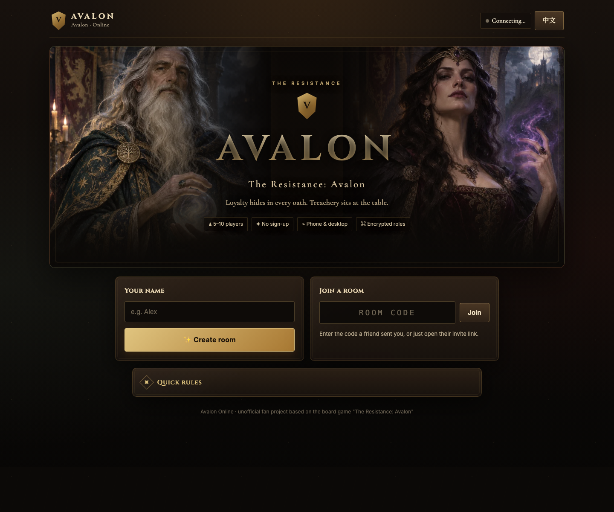

# Avalon Online

[English](README.md) · [简体中文](README.zh-CN.md)

An immersive, browser-based implementation of the social-deduction game *The Resistance: Avalon*. Create a room, share one link, and play with 5–10 people on phones or desktops—no account required.

**[Play Avalon Online](https://lorrainewong.github.io/avalon/)**



## Highlights

- **Complete 5–10 player game loop** — team proposals, public votes, secret quest cards, assassination, and rematches.
- **Seventeen supported character types** — the classic cast plus both Lancelots, Lunatic, Brute, Revealer, Cleric, Trickster, Troublemaker, and Untrustworthy Servant.
- **Optional Lady of the Lake** — available for games with seven or more players.
- **Big Box modules** — Excalibur and the Lancelot Allegiance variant are fully integrated into the encrypted multiplayer flow.
- **Private role delivery** — roles and player actions are encrypted in the browser with ECDH P-256 and AES-GCM.
- **Reconnect support** — room state is stored in Firebase Realtime Database, so a refreshed browser can resume the game.
- **Responsive Camelot interface** — optimized for desktop and portrait mobile play.
- **English and Simplified Chinese** — language can be switched at any time.
- **No build step** — the application is plain HTML, CSS, and JavaScript and can be hosted as a static site.

## How to Play

1. Open the [live game](https://lorrainewong.github.io/avalon/), enter a name, and create a room.
2. Share the invite link or five-character room code.
3. Wait for 5–10 players, configure optional roles, and start the game.
4. Keep the revealed role private. Discuss, propose teams, vote, and complete quests.
5. Good wins by completing three quests—unless the Assassin identifies Merlin. Evil wins by failing three quests or rejecting five consecutive proposals.

The in-game **Quick rules** panel includes role descriptions, quest rules, and player-count information.

## Architecture

```text
Player browsers
  ├─ Static UI and host-side game engine
  ├─ Anonymous Firebase Authentication
  ├─ Per-player ECDH key pair in localStorage
  └─ Encrypted role/action payloads
              │
              ▼
Firebase Realtime Database (Asia Southeast)
  ├─ public room and game state
  ├─ player seats and online presence
  └─ encrypted private payloads
```

The room host's browser advances the game state. Firebase synchronizes the room, seats, encrypted actions, and online presence between clients. If the host disconnects during a game, reopening the room link resumes host-side processing.

## Security Model

- Firebase uses anonymous authentication; players do not create application accounts.
- Each client generates an ECDH P-256 key pair. The private key remains in that browser's `localStorage`.
- The host encrypts each role separately with an ephemeral ECDH key and AES-GCM.
- Player actions are encrypted to the host before being written to Firebase.
- `database.rules.json` restricts game-state and secret writes to the host and seat writes to the corresponding player.
- The Firebase Web API key is a public project identifier by design. Authorization depends on Authentication and Security Rules, not on hiding that key; production keys must remain restricted to required Firebase APIs.

This design protects hidden roles from other normal clients and casual database inspection. It does not attempt to defend against a compromised host browser or a user modifying their own client.

## Run Locally

Requirements: a current browser and any static HTTP server.

```bash
git clone https://github.com/LorraineWong/avalon.git
cd avalon
python3 -m http.server 4173
```

Open <http://localhost:4173>. The checked-in configuration connects to the production Firebase project, so use clearly marked test names when developing against it.

To use a different Firebase project, define `window.AVALON_FIREBASE` before `app.js` loads and deploy the included `database.rules.json` to that project. Anonymous Authentication and Realtime Database must be enabled.

## Deploy

The production site is deployed from `main` with GitHub Pages. Because the app has no build step, any static host can serve the repository root.

For GitHub Pages:

1. Open **Settings → Pages** in the repository.
2. Select **Deploy from a branch**.
3. Choose `main` and `/ (root)`.

## Project Structure

```text
.
├── index.html                 # document shell and metadata
├── app.js                     # UI, encryption, networking, and game engine
├── style.css                  # responsive Camelot design system
├── assets/roles/              # optimized role portraits
├── database.rules.json        # Firebase Realtime Database rules
├── vendor/                    # Firebase compat SDK files
├── DESIGN.md                  # visual-system reference
├── README.md                  # English documentation
└── README.zh-CN.md            # Simplified Chinese documentation
```

## Verification

The current release was browser-tested on 13 November 2026 with five isolated clients, including four 390 px mobile viewports. The automated playthrough covered:

- three successful quests followed by a successful assassination of Merlin;
- five consecutive rejected proposals;
- three sabotaged quests;
- rematches in the same room;
- English and Chinese clients, encrypted role delivery, and responsive-width checks.

Result: **3 complete games, 42 state checks, 0 browser console errors, and no horizontal overflow.**

See the [full multiplayer playtest report](docs/PLAYTEST.md) for covered and deferred scenarios.

The new character behavior and the boundary of the current Big Box implementation are documented in [Big Box rules coverage](docs/BIG_BOX_RULES.md). Pure rule tests currently cover 16 character and module invariants.

For the trust model, disclosure process, and production security smoke test, see [SECURITY.md](SECURITY.md).

## Contributing

Bug reports and focused pull requests are welcome. When changing game flow, test with at least five isolated clients; a single browser cannot validate hidden information or multiplayer synchronization.

## Legal Notice

This is an unofficial, non-commercial fan project. *The Resistance: Avalon* and its game concepts belong to their respective rights holders. The character illustrations in this repository are original assets created for this interface and do not reuse official card artwork.
