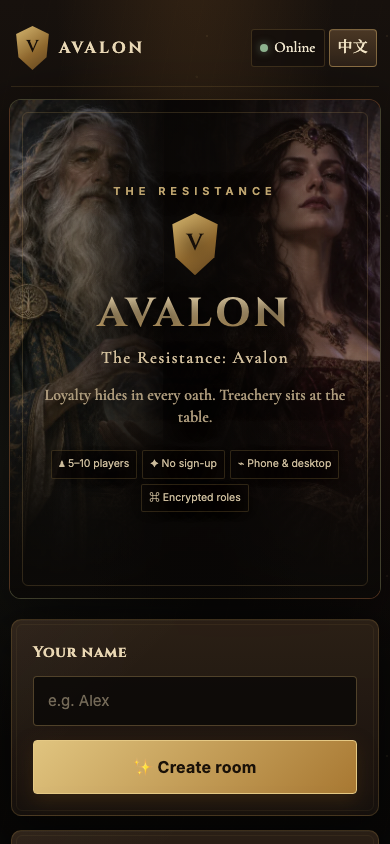

# Avalon Online · 阿瓦隆在线版

[English](README.md) · [简体中文](README.zh-CN.md)

一个可直接在浏览器中游玩的《抵抗组织：阿瓦隆》多人社交推理游戏。创建房间、分享链接，即可让 5–10 名玩家通过手机或电脑加入，无需注册账号。

**[立即开始游戏](https://lorrainewong.github.io/avalon/)**



## 主要功能

- **完整的 5–10 人游戏流程**：组队、公开投票、秘密任务、刺杀梅林和再来一局。
- **支持 17 类身份**：经典角色之外，新增善恶兰斯洛特、疯子、蛮兵、揭示者、牧师、骗术师、捣乱者和不可信的仆人。
- **可选湖中仙女**：7 人及以上的对局可以启用。
- **Big Box 模块**：王者之剑和兰斯洛特效忠转换已完整接入加密多人流程。
- **身份与行动加密**：浏览器使用 ECDH P-256 和 AES-GCM 分发身份并加密玩家行动。
- **刷新与重连**：房间状态保存在 Firebase Realtime Database，重新打开房间链接即可继续。
- **沉浸式 Camelot 界面**：针对桌面端和手机竖屏进行了响应式优化。
- **中英双语**：游戏过程中可以随时切换语言。
- **无需构建**：项目由原生 HTML、CSS 和 JavaScript 构成，可直接部署到静态网站托管服务。
- **临时房间**：新房间带有 72 小时有效期标记，已结束的游戏为 24 小时；房主重新连接后会清理过期资料。
- **无需账号的圆桌表情**：玩家可以发送短暂表情，不建立持久聊天记录。
- **可安装网页应用**：轻量 PWA 可让首页和规则离线打开；多人游戏仍然需要网络连接。
- **游戏内身份指南**：随时重看自己的能力，以及本局实际采用的完整身份阵容。
- **私人推理笔记**：可为每名玩家标记可疑阵营或具体身份，并把备注只保存在自己的浏览器里。

## 如何游玩

1. 打开[线上游戏](https://lorrainewong.github.io/avalon/)，输入昵称并创建房间。
2. 把邀请链接或五位房间码发送给其他玩家。
3. 等待 5–10 人加入，配置可选身份，然后开始游戏。
4. 私下查看自己的身份，通过发言、组队、投票和任务找出对方阵营。
5. 好人完成三个任务后仍需躲过刺客；坏人让三个任务失败，或让同一任务连续五次组队被否决，即可获胜。

游戏内的**规则速查**会先用四步说明完整流程，并列出本局实际采用的身份，随后提供所有支持身份的说明。私人推理笔记只保存在当前浏览器，不会分享给房间内其他人。

## 技术架构

```text
玩家浏览器
  ├─ 静态界面与房主端游戏引擎
  ├─ Firebase 匿名身份验证
  ├─ 保存在 localStorage 的玩家 ECDH 密钥
  └─ 加密的身份与行动数据
              │
              ▼
Firebase Realtime Database（亚洲东南区）
  ├─ 公开房间与游戏状态
  ├─ 玩家座位与在线状态
  └─ 加密的私人数据
```

房主的浏览器负责推进游戏阶段，Firebase 在玩家之间同步房间、座位、加密行动和在线状态。房主中途掉线时，重新打开房间链接即可恢复游戏推进。

## 安全模型

- Firebase 使用匿名登录，玩家不需要创建应用账号。
- 每个客户端生成一组 ECDH P-256 密钥，私钥只保存在该浏览器的 `localStorage`。
- 房主使用临时 ECDH 密钥和 AES-GCM 分别加密每名玩家的身份。
- 玩家行动会先加密给房主，再写入 Firebase。
- `database.rules.json` 限制只有房主能够写入游戏状态与秘密数据，每名玩家只能写入自己的座位数据。
- Firebase Web API Key 按设计就是公开的项目标识；权限由身份验证和 Security Rules 控制，不能依靠隐藏前端 Key。生产 Key 必须只允许本项目需要的 Firebase API。

该设计可以避免普通玩家客户端或简单数据库查看直接读取他人身份，但不防御被入侵的房主浏览器，也不阻止玩家修改自己的前端代码。

## 本地运行

只需要现代浏览器和任意静态 HTTP 服务器：

```bash
git clone https://github.com/LorraineWong/avalon.git
cd avalon
python3 -m http.server 4173
```

打开 <http://localhost:4173>。仓库中的默认配置会连接生产 Firebase，开发测试时请使用明显的测试昵称。

如需使用自己的 Firebase 项目，请在 `app.js` 加载前定义 `window.AVALON_FIREBASE`，并把仓库中的 `database.rules.json` 部署到对应项目。项目需要启用匿名身份验证和 Realtime Database。

## 部署

正式网站通过 GitHub Pages 从 `main` 分支部署。项目没有构建步骤，也可以直接部署到其他静态网站托管服务。

GitHub Pages 设置：

1. 打开仓库的 **Settings → Pages**。
2. 选择 **Deploy from a branch**。
3. 选择 `main` 和 `/ (root)`。

### 可选的支持开发链接

页尾可以显示自愿赞助按钮，网站本身不处理付款。在 `app.js` 之前定义链接：

```html
<script>window.AVALON_SUPPORT_URL = 'https://ko-fi.com/yourname';</script>
```

不设置时按钮会自动隐藏。游戏应保持免费，并使用托管支付平台，不要在 GitHub Pages 上自行收集信用卡资料。

公开页尾也提供中英双语的隐私说明和非官方作品声明。完整隐私说明请查看 [PRIVACY.md](PRIVACY.md)。

## 项目结构

```text
.
├── index.html                 # 页面外壳与元数据
├── app.js                     # 界面、加密、网络和游戏引擎
├── style.css                  # 响应式 Camelot 视觉系统
├── assets/roles/              # 优化后的身份人物图片
├── database.rules.json        # Firebase Realtime Database 规则
├── vendor/                    # Firebase compat SDK 文件
├── docs/                      # 设计说明、规则覆盖与测试报告
├── scripts/                   # 源码与规则检查脚本
├── .github/                   # 自动检查和贡献模板
├── README.md                  # 英文主文档
└── README.zh-CN.md            # 简体中文文档
```

## 功能验证

当前版本于 2026 年 11 月 13 日使用 5 个相互隔离的浏览器客户端完成测试，其中 4 个客户端使用 390px 手机视口。自动对局覆盖：

- 三次任务成功后，刺客成功刺中梅林；
- 连续五次组队被否决；
- 三次任务被坏人破坏；
- 同一房间内连续重开游戏；
- 中英文客户端、身份加密分发和响应式宽度检查。

结果：**完整完成 3 局游戏、42 项状态检查、0 个浏览器控制台错误、0 个横向溢出。**

完整覆盖范围和暂未测试的场景请查看[多人测试报告](docs/PLAYTEST.md)。

新增角色的准确行为、官方依据和当前未实现模块请查看 [Big Box 规则覆盖说明](docs/BIG_BOX_RULES.md)。目前纯规则单测覆盖 16 项身份与模块不变量。

全部项目文档集中在 [docs/README.md](docs/README.md)。发布游戏流程改动前，请运行 Pull Request 模板中列出的仓库检查。

安全边界、漏洞报告方式和生产规则回归测试请查看 [SECURITY.md](SECURITY.md)。

## 参与贡献

欢迎提交 Bug 报告和范围清晰的 Pull Request。修改游戏流程时，请至少使用 5 个相互隔离的客户端进行测试；单个浏览器无法验证隐藏身份和多人同步。

## 法律说明

本项目是非官方、非商业的粉丝作品。《抵抗组织：阿瓦隆》及其游戏概念属于各自权利方。仓库中的人物插画是专为此界面创作的原创素材，没有使用官方卡牌图片。
